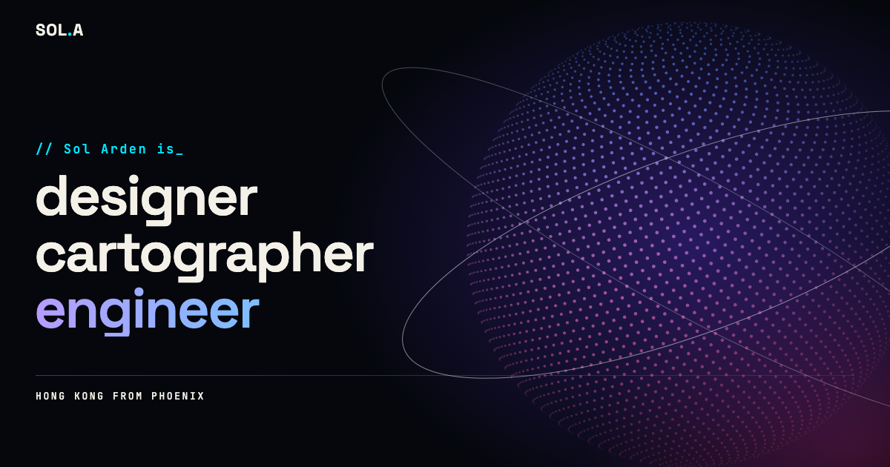

# orbit

A one-page portfolio website you can copy and make your own. Behind the text sits a cloud of
glowing points that rearranges itself into a new picture each time you scroll to the next section:
the Earth, a harbour at night, a desert sunset, a city skyline.

**See it live: <https://orbit.jun-liu.net>**



> The person on the page, **Sol Arden**, is made up, and so are the projects, employers and
> school. Links point at `example.com`. Replace them with your own.

## Contents

- [What you see](#what-you-see)
- [Run it on your computer](#run-it-on-your-computer)
- [Make it yours](#make-it-yours)
- [Put it online](#put-it-online)
- [Built to hold up](#built-to-hold-up)
- [Files](#files)
- [Licence](#licence)

## What you see

The same cloud of points forms a different picture behind each section of the page:

| Section       | Picture                                                                      |
| ------------- | ---------------------------------------------------------------------------- |
| Hero, Contact | The Earth, drawn from real coastlines, with an arc from Phoenix to Hong Kong |
| About         | Victoria Harbour at night                                                    |
| Work          | The Sonoran desert at sunset                                                 |
| Expertise     | The New York skyline                                                         |
| Experience    | Paris                                                                        |
| Toolkit       | A star field                                                                 |

The points are drawn with WebGL using [Three.js](https://threejs.org), which is included in this
repository, so there is nothing to download or install.

## Run it on your computer

You need [Node.js](https://nodejs.org) (version 22 is what the deploy uses) and Python 3, which
most computers already have.

1. Build the site. This writes the finished pages into a `dist/` folder:

   ```bash
   node scripts/build.mjs
   ```

2. Serve that folder:

   ```bash
   python3 -m http.server -d dist 8000
   ```

3. Open <http://localhost:8000> in your browser.

The contact form needs a server behind it, so on your computer it will say it could not send.
That is expected.

## Make it yours

- **Words:** everything visible is in `index.html`. The logo (`Sol.A`) appears in the loader and
  the header.
- **Web address:** replace `orbit.jun-liu.net` in `index.html`, `robots.txt` and the `SITE`
  constant in `scripts/build.mjs`.
- **Preview image:** `og-image.png` (1200 x 630) is what shows when the link is shared. It carries
  the name, so replace it.
- **Pictures:** the `THEMES` array at the top of `main.js` sets each section's colours and
  picture. The pictures are drawn by `harbour()`, `desert()`, `newYork()` and `paris()`; each
  landmark is a line or two, so they are easy to change. The arc's two cities are `PHX` and `HKG`.
- **Contact form:** it posts JSON to `/api/contact` and expects `{ ok: true }` back, or `422`
  with `{ errors: { field: message } }`. Point it at your own service, or swap the form for a
  `mailto:` link.
- **Languages:** English only for now. Add a `locales/<language>.json` file of
  `[English, translated]` pairs with `"published": true`, and the build writes a page for it.

## Put it online

The built `dist/` folder is plain files, so any static web host can serve it.

This repository also includes a `Dockerfile` that builds the site into a
[Caddy](https://caddyserver.com) web server image listening on port 8080:

```bash
docker build -t orbit .
```

```bash
docker run -p 8080:8080 orbit
```

The server forwards `/api/contact` to `contact-api:3001`. That is a placeholder for your own
service; until one exists, the form shows its error message.

The live copy at <https://orbit.jun-liu.net> runs on a home server that checks the `development`
branch every minute and rebuilds when there is a new commit. It has no contact service yet.

## Built to hold up

- If the script fails or is blocked, the loading screen steps aside after 8 seconds and the
  content shows. With JavaScript off, it shows straight away.
- Motion is reduced for visitors who have asked their device for less motion
  (`prefers-reduced-motion`).
- Phones and slow machines get fewer points and a lower resolution, so it stays smooth.
- The contact form is kept separate from the animation, so it still works if WebGL does not.

## Files

| File                                 | What it is                               |
| ------------------------------------ | ---------------------------------------- |
| `index.html`, `style.css`, `main.js` | The site                                 |
| `contact.js`                         | The contact form                         |
| `404.html`                           | The "page not found" page                |
| `og-image.png`                       | The image shown when the link is shared  |
| `vendor/three.module.min.js`         | Three.js r160 (MIT licence)              |
| `scripts/build.mjs`                  | The build, which also writes the sitemap |
| `Dockerfile`, `Caddyfile`            | The deploy                               |

## Licence

[MIT](LICENSE): free to use, change and share, including commercially, as long as the licence
notice stays with it. Three.js (in `vendor/`) is also MIT. The coastline data comes from Natural
Earth, which is public domain.
